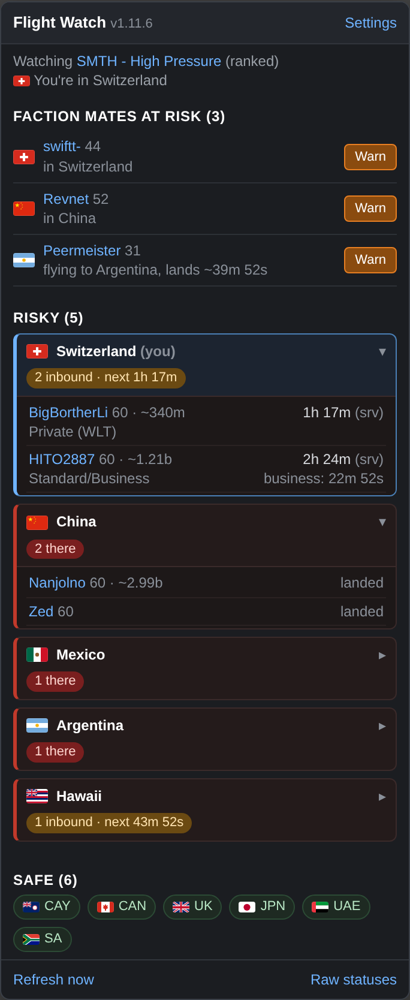

# Torn Flight Watch

A userscript for Torn City, for Tampermonkey in a browser or Torn PDA on a phone. It tracks the factions you're at war with and shows which countries are safe or risky. It warns you when enemies fly to, land in, or leave the country you're in or heading to. It also lists faction mates flying into danger, with a Warn button that writes the message for you.

## Install

**Browser (Tampermonkey)**
1. Install [Tampermonkey](https://www.tampermonkey.net/).
2. Open the [raw script](https://raw.githubusercontent.com/mat-mcc-uk/torn-flight-watch/main/torn-flight-watch.user.js) and click **Install**.
3. Load any torn.com page, tap the **Fly** button in the bottom-left corner, open **Settings** and paste in a Public API key.
4. When Tampermonkey asks about a cross-site request, choose **Always allow domain**. The script talks to `supabase.co` (the faction server), `ffscouter.com` (battle stat estimates) and, if you add a webhook, `discord.com`.

Tampermonkey checks for updates on its own schedule. To update straight away, use **Utilities > Check for userscript updates** in its dashboard.

**Torn PDA**
1. Go to **Settings > Userscripts**, add a script from a URL, and paste the raw link above.
2. PDA fills in your API key itself, so there's nothing to set up.

Install it once only. If you reload it and end up with two Flight Watch entries, delete one, because two copies overwrite each other's data. The panel shows a red warning if it spots a second copy. The panel header shows the running version, so you can check an update has landed. GitHub can take up to 5 minutes to serve a new version after a push.

On PDA 3.15 or later the script saves its data in PDA's native storage (the green storage badge on the Userscripts page). That keeps it out of the browser's shared 5 MB on torn.com, which Torn's chat and other scripts can fill up.

## What it does

**Enemy factions**
- **Auto mode** watches whoever your faction is at war with: the ranked war opponent from the moment the war is matched, plus raids and territory wars if you tick that option.
- **Fixed mode** takes one or more faction IDs, comma separated.

**Country board**
- Risky countries come first as cards, each with a flag and counts for enemies there, in hospital, and inbound with the next landing time. Your own country sits on top and opens automatically. Tap any card to see names, plane types, landing countdowns and FFScouter battle stat estimates.
- A country is risky when any enemy is there, in hospital there, or flying there. Enemies flying home don't count.
- Safe countries fold into a row of flags. While you're in Torn, tap one to open the travel agency with that destination already selected. You still choose the ticket and press Travel yourself. The script never confirms a flight.

**Your location**
- The script reads your own status, so it knows the country you're in or flying to.
- The button turns green or red for that country and shows how many enemies are there or on the way.
- In Torn, the button shows how many countries are risky (red) and how many faction mates are at risk (orange).

**Faction mates at risk** (needs the server)
- Lists faction mates who are in, or flying to, a risky country, most urgent first.
- **Warn** opens a Torn message to that player with the subject and the warning already written in. The warning names each enemy, with landing times and battle stat estimates, for example: *"Heads up from Flight Watch: Argentina is risky. In Argentina now: tazzy91 (~2.99b). On the way: HITO2887 (~1.21b), lands in about 1h 56m. You land in Argentina in about 39m. Stay safe!"* You check it and press Send, because Torn's rules don't allow scripts to send messages. The warning is also copied to your clipboard.
- The fill-in only writes inside Torn's "Send a Message" box, never anywhere else on the page, and never over text already in the box.

**Battle stat estimates**
- Come from [FFScouter](https://ffscouter.com/). Your Torn key is used by default. It must be registered at ffscouter.com, which it will be if FFScouter already works for you. If you use a different key for FFScouter, put it in **FFScouter key** in Settings.
- Only enemies away from Torn are looked up. Each estimate is kept for 6 hours.

**Alerts** (only for the country you're in or flying to)
- Safe/risky summary when you take off somewhere
- Enemy takes off for your country, with plane type and estimated landing time
- Enemy about to land (5 minutes before by default)
- Enemy landed
- Enemy leaves your country (off by default)

Alerts show as browser notifications and an on-page toast, and can also post to a Discord webhook.

## Settings

| Setting | What it does |
| --- | --- |
| Public API key | Your Torn key. Filled in automatically on PDA. |
| Enemy | Whoever you're at war with, or fixed faction ID(s). |
| Include raids and territory wars | Auto mode: watch those opponents as well as the ranked one. |
| Poll every (sec) | How often the script checks. Default 30, minimum 15. |
| Warn before landing (min) | When the "about to land" alert fires. Default 5. |
| Discord webhook | Optional. Alerts are also posted there. |
| FFScouter key | Optional. Blank means your Torn key. |
| Server token override | Leave blank. Only needed if the server token is changed before the script is updated. |
| Alert switches | Turn each alert on or off. |
| Show faction mates in danger | The danger list and Warn buttons. |
| Show FFScouter battle stat estimates | Estimates in the panel and in warnings. |

## How landing times are worked out

The Torn API doesn't give another player's arrival time, but it does say which plane they're on (`plane_image_type`):

| Plane | Travel type |
| --- | --- |
| `light_aircraft` | Airstrip |
| `private_jet` | Private (WLT) |
| `airliner` | Standard or business class |

The takeoff time is estimated as halfway between the last poll that saw the player in Torn and the first one that saw them flying, and the country's flight time is added to that. Business class uses the same airliner image as standard, so airliner flights show both countdowns, and the landing alert still catches business-class arrivals. If the gap between those two polls is long (a closed tab, missed server runs), the takeoff time is left unknown rather than guessed.

With the server running, every flight gets a takeoff time, even when nobody had Torn open. Countdowns based on the server's time show `(srv)`.

Flight times are in the `DESTS` table at the top of the script.

## Server

The server runs on Supabase. It polls your faction and the enemy factions every 30 seconds around the clock.

- `supabase/functions/flight-watch-poll` is called by `pg_cron` every 30 seconds. It works out who the faction is at war with (rechecked every 5 minutes) and fetches the enemy members and your own faction's members. It stores each player's location and estimated takeoff time, with your own faction marked `side = 'friend'`.
- `flight_watch_read` is a database function, called through Supabase's REST API. It returns enemies away from Torn as `members` and faction mates away as `friends`. It checks the read token and allows up to 4 fresh reads per IP every 10 seconds, using the IP Cloudflare attaches to the request, which clients can't fake. Reads this way don't count against the edge function quota.
- `supabase/functions/flight-watch-read` is retired. It's kept only to tell very old script versions to update.
- `supabase/migrations` holds the tables, the read function and the cron job.

The script ships with the read token and the project's publishable key built in, so nobody has to set anything up. The token only unlocks player locations, which all come from the public Torn API. To rotate it, run `update flight_watch_secrets set read_token = encode(gen_random_bytes(12), 'hex');`, put the new value in `SERVER_TOKEN`, and bump the version.

The server uses one Public Torn API key, stored as the `TORN_API_KEY` edge function secret. The key must belong to a member of your faction, because it decides which wars count and whose travel counts as "friend". The tables have row level security on and no public policies, so only the server functions can read them.

## API usage

Everything works with a Public key. When the server's data is less than 2 minutes old, the script reads player positions from the server, and your key is only used to check your own status: one call per poll. If the server is down or behind, or you're in fixed-faction mode, the script fetches the enemy factions itself instead (one call per faction per poll, plus the war lookup every 5 minutes). FFScouter lookups are batched and cached.

Only one Torn tab polls at a time, so several open tabs don't double up the calls or the alerts. A newer copy of the script takes over polling from an older one straight away.

## Troubleshooting

Open the panel and tap **Raw statuses**. It shows:
- **Storage:** Tampermonkey, PDA native storage or localStorage. A red "Saving failed" line means the browser storage on torn.com is full. The script keeps working from memory, but clearing PDA's chat cache (Settings > Browser settings) frees space for everything.
- **Server and Server data:** whether the server answered, how old its data is, and how many enemies and faction mates it reports away.
- **FFScouter:** whether estimate lookups are working.
- **Enemy data from:** whether the board is built from the server or straight from the Torn API.
- **Every enemy away from Torn:** the exact status the API gave and how the script read it.
- **Travel page or Message page report:** when tap-to-fly or Warn can't do its job, the script saves a short report of what the page contained. Tap **Copy** and send it to the author, so the script can be matched to Torn's page.

## Known gaps

- Alerts only fire while a Torn page is open somewhere. The server keeps tracking regardless.
- Torn shows "In hospital for X mins" without a country, so an enemy in hospital abroad may count as in Torn. The script also checks for wording like "In a Japanese hospital", in the `adj` lists in `DESTS`.
- Tap-to-fly and Warn depend on the layout of Torn's travel and message pages. If Torn changes them, the script says so and saves a report, and the warning stays on your clipboard.

## Changes

See [CHANGELOG.md](CHANGELOG.md).

## Author

Ripcorder [4252513]
